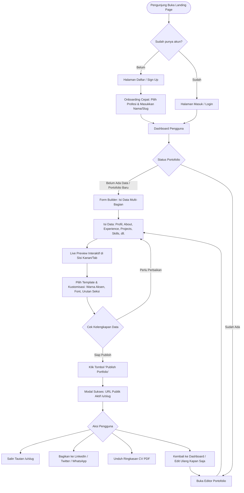
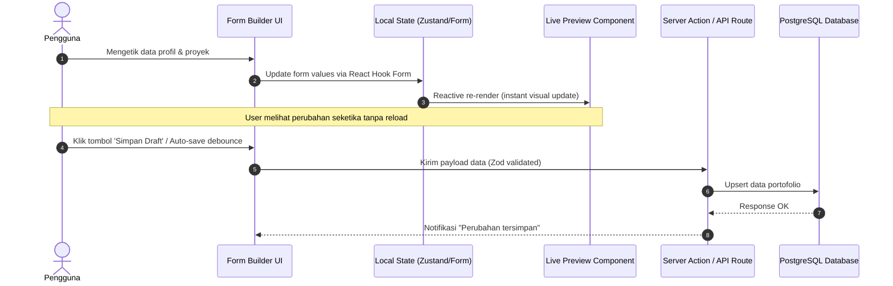

# 03. Alur Pengguna (User Flow) & Diagram Interaksi

Dokumen ini memetakan seluruh perjalanan pengguna (*user journey*) dari pertama kali mengunjungi platform hingga mempublikasikan dan membagikan website portofolio mereka.

---

## 1. Diagram Alur Keseluruhan (End-to-End User Flow)

---

## 2. Rincian Langkah demi Langkah (Step-by-Step Breakdown)

### Tahap 1: Landing Page & Discovery
- Pengguna melihat demonstrasi interaktif, fitur utama, galeri contoh 4 template portofolio, dan ulasan pengguna.
- CTA Utama: *"Buat Portofolio Gratis Sekarang"*.

### Tahap 2: Autentikasi & Onboarding Kilat
1. **Pendaftaran:** Input Email + Password atau 1-Click Login dengan Google/GitHub.
2. **Onboarding Mini (30 detik):**
   - Masukkan Nama Lengkap & Headline Profesi (e.g., *"Frontend Engineer"* atau *"UI/UX Designer"*).
   - Tentukan Custom Slug URL Portofolio (e.g., `portfolio-builder.com/u/nama-anda`).
   - Pilih peran utama untuk rekomendasi template awal.

### Tahap 3: Form Data Builder (Struktur Modular)
Editor dirancang dengan navigasi tab vertikal/horizontal yang terorganisir:
- **Tab 1: Profil & Kontak** (Foto, Nama, Headline, Bio, Lokasi, Email, Sosial Media).
- **Tab 2: Tentang Saya (About)** (Cerita karier, fokus saat ini, ketersediaan kerja).
- **Tab 3: Pengalaman & Pendidikan** (Timeline pekerjaan, magang, riwayat kampus).
- **Tab 4: Keahlian (Skills)** (Kategori keahlian, tech stack badges).
- **Tab 5: Proyek Unggulan (Projects)** (Upload gambar, deskripsi, live demo, github link).
- **Tab 6: Sertifikat & Testimoni** (Bukti kompetensi dan rekomendasi rekan).

### Tahap 4: Pemilihan Template & Styling Real-Time
- Pengguna dapat beralih di antara **4 Template Utama** (Minimalist, Bold, Developer, Elegant).
- Memilih palet aksen warna (*Primary Accent Color*) dan kombinasi tipografi.
- Tombol toggle untuk menyembunyikan seksi yang belum memiliki data (misal: belum punya sertifikat -> seksi sertifikat otomatis tidak tampil di web publik).

### Tahap 5: Publikasi & Distribusi
1. Klik **"Publish"**: Validasi slug unik dan data minimum (nama & headline).
2. Status berubah dari `DRAFT` menjadi `PUBLISHED`.
3. Server memicu on-demand revalidation untuk rute `/u/:slug`.
4. Pengguna disajikan tautan publik langsung, QR Code, dan tombol share instan ke LinkedIn, WhatsApp, dan Twitter/X.
5. Pengguna dapat kembali kapan saja ke dashboard untuk memperbarui data, dan perubahan langsung ter-update di link publik.
